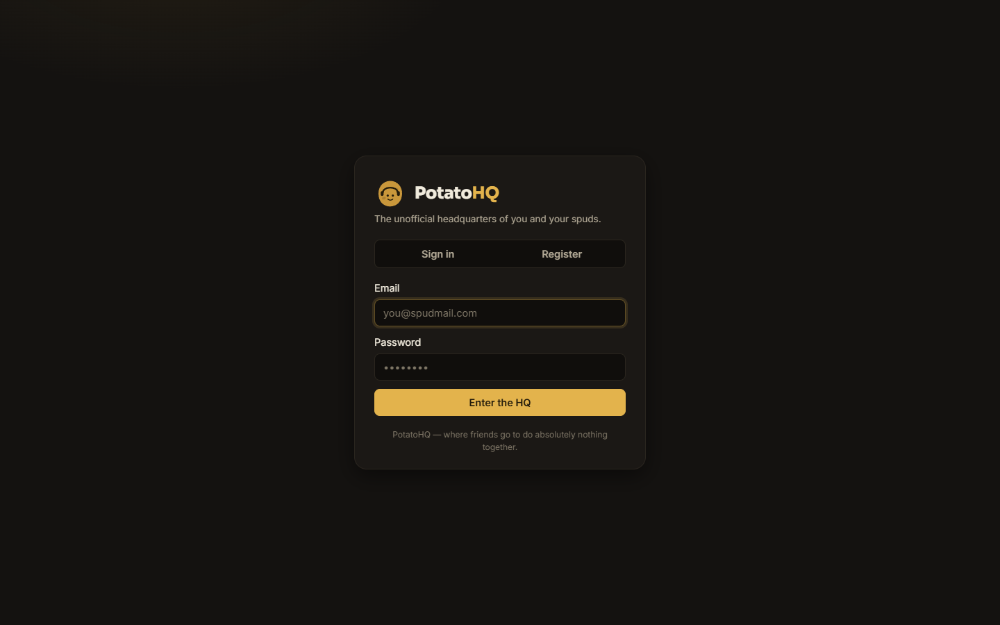
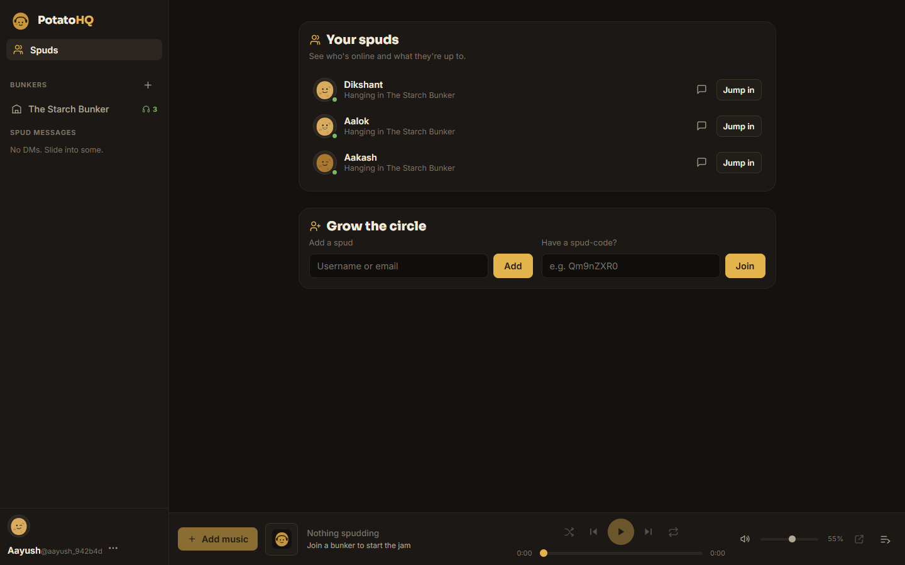
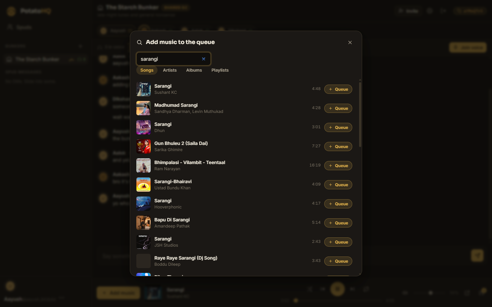
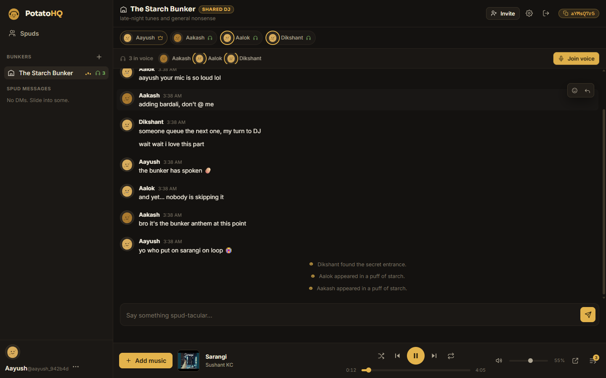
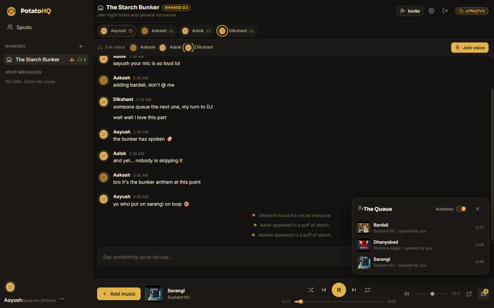
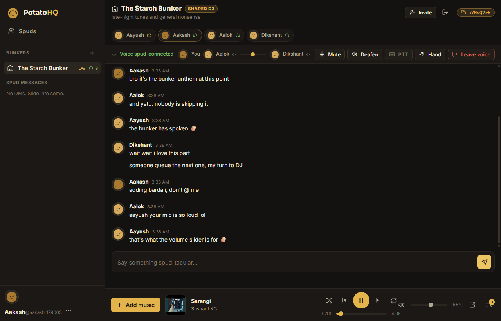
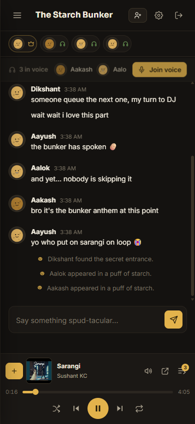
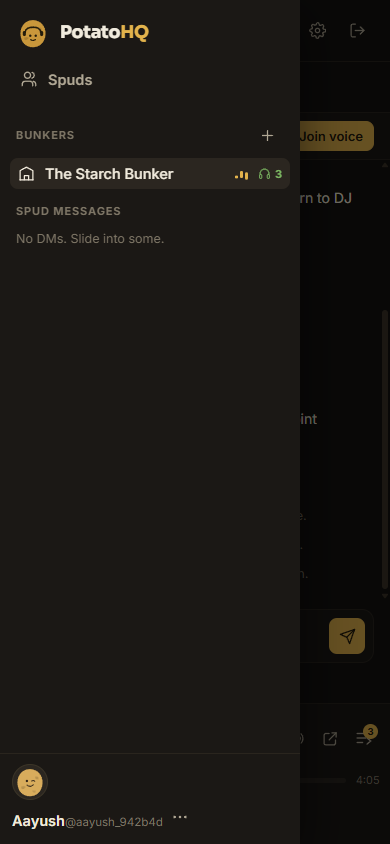

# PotatoHQ 🥔 — your friends' digital hangout

**A self-hosted clubhouse for your friend group**: private rooms, real-time chat, voice, and a
shared music queue that keeps playing — with playback synchronized by the server so everyone
hears the same song at the same moment.

 
 
 

No build tools, no npm install, no message queues — one Python process and a folder of
static files. Clone, `python run.py`, share the URL. Installable as an app on phones and
desktops (PWA).

```bash
git clone https://github.com/<you>/PotatoHQ.git
cd PotatoHQ
pip install -r requirements.txt
python run.py          # → http://localhost:8420
```

Everyone on the same Wi-Fi opens `http://<your-ip>:8420`, registers, and drops in.

## Screenshots

| | |
| --- | --- |
|  |  |
|  |  |
|  |  |
|  |  |

*Four friends — Aayush, Aakash, Aalok and Dikshant — hanging out in "The Starch Bunker".
Now spudding: **Sarangi — Sushant KC**, with Bardali and Dhanyabad queued up; chat, voice with
per-spud volume, and a live shared queue on desktop and mobile.*

## What's inside

| Area | Details |
| --- | --- |
| **Accounts** | Email + password registration, scrypt hashing, HttpOnly session cookies (hashed at rest), profiles, uploaded pictures or generated potato avatars, online/last-seen status. |
| **Friends** | Add by username/email, requests in/out, accept/decline/unfriend, live presence + activity ("In voice · Bunker", "Hanging in…"), jump-in buttons. |
| **Rooms ("bunkers")** | Private rooms with shareable spud-codes, member invites, owner controls (kick, rename, topic, delete), live member strip with role/mic/listening indicators. |
| **Chat** | Real-time messages with history + infinite scroll, typing indicators, unread badges, replies, emoji reactions (🥔 included), edit & delete, per-room drafts, "jump to latest". |
| **Voice** | WebRTC mesh with mute, **deafen**, **per-spud volume (0–200%)**, **push-to-talk (hold V)**, **raise hand**, speaking rings, connection status, listen-only fallback, mic test. |
| **Audio settings** | Microphone picker (hot-swap mid-call), output device picker, echo-cancellation & noise-suppression toggles, live mic level meter. |
| **Music discovery** | YouTube Music search (songs, artists, albums, playlists) via [`ytmusicapi`](https://github.com/sigma67/ytmusicapi), radio/related tracks for autoplay, album & playlist browsing. `Ctrl+K` to search from anywhere. |
| **Shared player** | Server-authoritative queue + state: play/pause/seek/skip/prev, shuffle, repeat (off/all/one), autoplay when the queue runs dry, owner vs. shared-DJ modes, local volume, recently-spudded history with one-click re-queue. Artwork-only visuals — no video preview. |
| **Sync** | Server timestamps + anchor-based position math, 10 s reconciliation ticks, client self-healing seeks, version counters + room locks preventing double transitions, automatic reconnect recovery. |
| **Installable app** | PWA manifest + service worker — "Install app" / "Add to Home Screen" with offline shell caching. |

## How it works

```
server/                FastAPI (Python 3.10+)
  main.py              app assembly, WebSocket endpoint, static files, CSRF guard
  db.py                SQLite (WAL) schema + helpers
  security.py          scrypt password hashing, session tokens (stored hashed)
  models.py             wire payloads: user cards, potato avatars, message dicts
  hub.py                realtime hub: connections, presence, voice roster, fan-out
  player.py             authoritative playback state machine + per-room ticker
  ytm.py                ytmusicapi wrapper (metadata only: cache + limits + timeouts)
  wsapi.py              WS protocol: chat, voice signaling, music control
  routes/               REST: auth, social (friends), rooms, music discovery
web/                   no-build ES-module SPA
  assets/js/            store / ws / api / views (auth, home, chat, player, queue,
                       search, voice, modals) + hand-rolled design-system CSS
data/                  SQLite DB + uploaded avatars — created at runtime, never committed
tests/                 protocol, browser E2E, layout/recovery, design probes, diagnostics
```

### Playback provider — capabilities and restrictions (verified up front)

* **Discovery** is `ytmusicapi` — metadata only (titles, artists, durations, artwork, radio
  candidates). It is not an audio-streaming engine.
* **Playback** is the official **YouTube IFrame Player API**, embedded behind the album
  artwork (full 200×200 layout size per embed requirements, visually covered — no video
  preview anywhere).
* The player reports buffering, real durations, `onError` codes (2/5/100/101/150) and
  `onAutoplayBlocked`. PotatoHQ maps:
  * **errors 100/101/150** → track skipped with a breather between skips and avoided by
    autoplay; search puts YouTube Music *audio tracks* first (ATV), which reliably allow
    embedding while many official videos (T-Series, some Vevo) refuse. If the autoplay
    radio alone keeps failing, the player pauses with a friendly chat message instead of
    strobing the room — your queue is always drained first.
  * **autoplay blocked** → a one-time "tap anywhere to start listening" hint; playback only
    proceeds when the room is actually playing, so local audio and shared state can never
    disagree.
  * **real durations** → reported to the server to correct metadata and schedule transitions.
* The provider is modular: YT-specific code lives in `server/player.py` and the single
  `PotatoPlayer` class in `web/assets/js/player.js`. Swap providers by replacing those two
  integration points.

### Synchronization model

* The server stores `position @ anchor` + `playing` per room; expected position is
  `position + (now − anchor)` while playing.
* A per-room **ticker task** advances tracks at `duration − ε`; client "ended" reports are a
  fallback guarded by the room lock, a version counter, and a per-video dedupe window — many
  clients reporting the same end cause exactly one transition.
* Clients sample server-clock skew (EWMA) and self-heal by seeking when drift exceeds 3 s;
  a 10 s `music.tick` reconciliation is broadcast to every member.
* Joining or rejoining a room returns the full snapshot, so reconnects recover the live
  state instead of starting a separate session.
* Voice and music run side by side: WebRTC audio is independent of the YouTube embed, and
  echo cancellation keeps the music out of your mic.

## Testing

```bash
pip install -r requirements.txt
python run.py                    # terminal 1

python tests/smoke_test.py       # 61 protocol/API checks (2 accounts, live WebSockets)
python tests/browser_e2e.py      # 36 checks across two real browser sessions
python tests/layout_recovery_test.py  # 60-message flood + server kill/restart recovery
python tests/design_probe.py     # design-token, contrast and layout probes
python tests/screenshots.py      # regenerates docs/screenshots/
```

The browser E2E registers two separate browser contexts (separate sessions), friends them,
builds a room through the real modals, exchanges live messages/reactions/replies, verifies
unread badges, queues real music through the live YouTube Music search, asserts both
sessions stay in sync through adds/skips/ends, establishes real WebRTC peer connections
with fake microphones, and exercises deafen, per-spud volume, push-to-talk, raise-hand,
audio device settings and the mobile drawer.

## Hosting it for your friend group

PotatoHQ is one long-lived process with WebSockets, on-disk SQLite and in-memory realtime
state — so serverless platforms (Vercel & friends) can't host it. These can, for free:

**Same Wi-Fi (easiest):** run `python run.py`, share `http://<your-lan-ip>:8420`.

**Free TURN for voice across networks** (picked up automatically via `/api/rtc/config`):

```bash
POTATO_TURN_URL=turn:openrelay.metered.ca:80 \
POTATO_TURN_USER=openrelayproject \
POTATO_TURN_CRED=openrelayproject \
python run.py
```

**Option A — your PC + Cloudflare Tunnel** (public HTTPS URL in ~10 minutes, no port
forwarding): install [cloudflared](https://developers.cloudflare.com/cloudflare-one/connections/connect-networks/downloads/),
then run `expose.cmd` (or `cloudflared tunnel --url http://localhost:8420`) and share the
printed `https://xxxx.trycloudflare.com` URL.

**Option B — Oracle Cloud "Always Free" VM** (always-on 24/7, never billed): create an
Ampere A1 VM, open ports 22/80/443/8420, then run the provided `Dockerfile` with a data
volume and Caddy in front for HTTPS (`POTATO_SECURE_COOKIES=1` once on HTTPS). SQLite and
uploads persist in the volume; back it up and your HQ is immortal.

Environment knobs: `POTATO_HOST`, `POTATO_PORT`, `POTATO_SECURE_COOKIES`,
`POTATO_TURN_URL/_USER/_CRED`, `POTATO_WS_DEBUG` (log every WS message type).

## Security

* Server-side authorization on every room/DM resource and every WS action; RTC relay works
  only between voice members of the same room.
* HttpOnly + SameSite=Lax cookies; tokens stored hashed; custom `X-Potato` header required
  on mutations as a CSRF guard; WS handshakes origin-checked.
* Input validation + rate limits; parameterized SQL everywhere; the frontend renders text
  via `textContent` only (no user HTML); avatar uploads are magic-byte-checked and
  size-capped; no secrets in frontend code.

## Notes & limitations

* Voice is a P2P mesh — perfect on a LAN; add a TURN relay (above) for internet-grade NAT
  traversal.
* Some YouTube tracks refuse embedding (errors 101/150); they're skipped, announced in
  chat, and avoided by autoplay.
* Output-device selection applies to spud voices; the YouTube embed's audio follows the
  browser default (a platform limit of cross-origin iframes).

## License

[MIT](LICENSE) — do whatever, just keep the notice. Not affiliated with YouTube, Google, or
Discord (obviously — the HQ has better taste in tubers).

*The product is funny without being poorly designed, technically solid without feeling
corporate, and memorable enough that you'll never forget the name PotatoHQ.* 🥔
